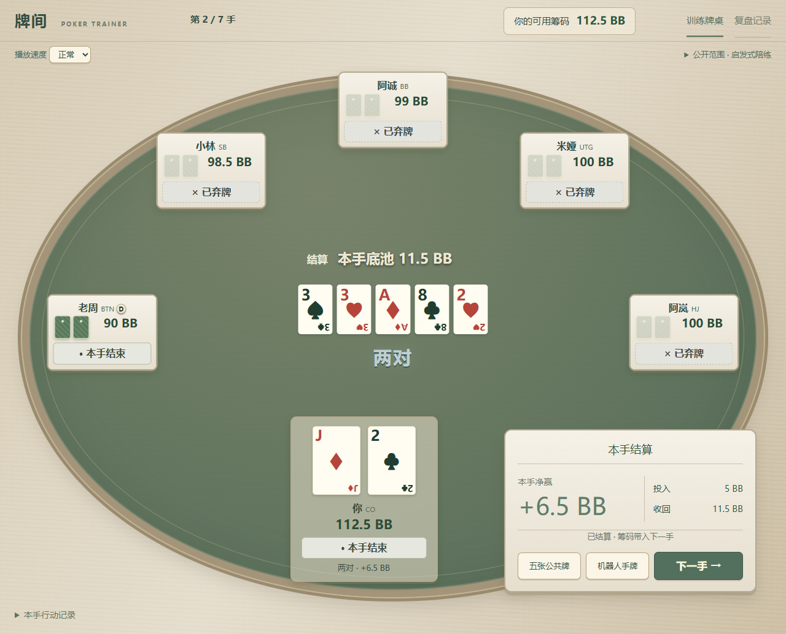
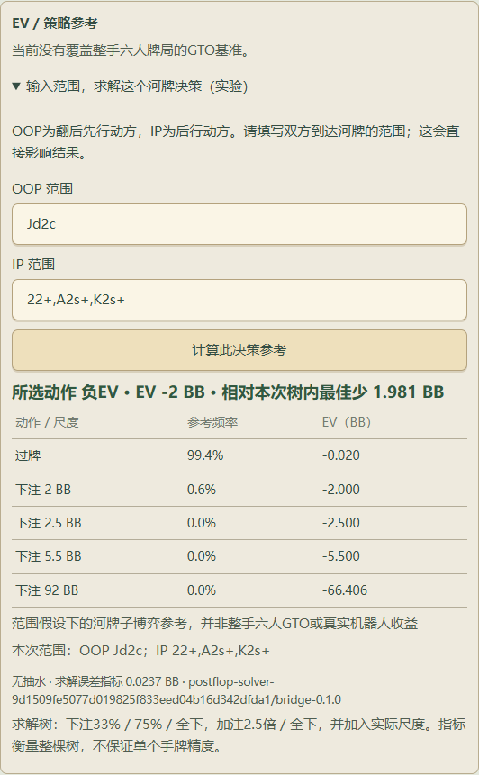

# 牌间 · Poker Trainer

**把每一手，变成下一手的经验。**

一款围绕连续训练、清晰行动与逐步复盘打磨的本地德州扑克训练原型。本仓库是独立的公开产品展示，包含静态案例页面、真实产品截图与一个可点击的固定牌谱回放。



## 先看体验

- **连续训练**：六人现金桌，你与 5 位机器人同桌；0.5 / 1 BB、无抽水。当前运行中的训练组可追加 1–1000 手，保留筹码、公开行为观察与轮换。
- **看清行动**：明确区分弃牌、跟注、加注至和全下；结算分别展示投入、收回与净收益。
- **回到决策**：按训练组和手数查找全部已保存牌局；按街与行动回看，只展示节点当时已发出的公共牌。

## 浏览静态展示

本页的介绍、截图和功能说明可以直接在 GitHub 浏览，无需下载。

下载本仓库后，直接用浏览器打开 `index.html` 即可。所有样式、脚本与图片均使用本地相对路径，无依赖、无需安装、无需后端。

页面内的「体验一手回放」提供 5 个固定节点：翻前、翻牌、转牌、河牌与结算。可点击节点、使用前后按钮，或在演示按钮聚焦时使用左右方向键。演示遵循当前节点的公共牌可见性，不进行策略求解。

> 这是固定脚本回放，不能在线开局。完整游戏是另行在本地运行的开发原型；本仓库只发布展示材料，不包含游戏后端、模型或训练记录。没有提供已上线地址。

## 设计与工程

| 关注点 | 已实现的行为 |
| --- | --- |
| 规则与筹码 | 短码盲注、不完整全下加注权、多边池与余码分配，以及投入 / 收回对账 |
| 信息边界 | 机器人与推荐策略不接收对手实际隐藏底牌或未来公共牌 |
| 连续性 | 同组追加手数；重启后可查已保存牌谱；跨组同手数记录分别识别 |
| 验证 | 当前开发版本通过 104 项 Python 测试、5 项原生组件测试，以及 Edge 完整 20 手流程验收 |

上述数字是开发版本的工程验证快照，不是机器人棋力或策略收益的证据。陪练使用公开范围启发式，可选 Fullhouse 模型在本地配置可用时加载。

## 实验中的河牌策略参考

本地开发版接入了真实开源 [postflop-solver](https://github.com/b-inary/postflop-solver)（AGPL-3.0），当前只处理**仅剩两位玩家、英雄首次河牌决策**的符合条件局面。

双方范围必须手动输入。有限行动树包含 33% / 75% / 全下及 2.5 倍加注 / 全下，并加入实际行动尺度。频率、EV 与树内差值依赖这些范围、行动树及求解状态；未覆盖或求解状态不合格时不评分。平均收敛指标不保证某手牌的误差。



这不是六人整局 GTO 分析。自动范围推断、更广的局面覆盖与独立棋力评估仍未完成。本静态页面不包含或运行求解器；截图中数值仅用于展示结果表达方式。

## 仓库内容

```text
index.html       产品案例与交互演示
style.css        自适应版式与视觉样式
demo.js          固定脚本牌谱回放
assets/          两张隔离测试生成的真实产品截图
PUBLISHING.md    发布范围与隐私核对说明
```

界面支持桌面与移动屏幕、键盘焦点与减少动态效果偏好。不引用外部字体或分析服务。

公开主页：[con3eited-dot](https://github.com/con3eited-dot)
